Animated cover · show or hide

<h1>
<picture>
  <source media="(max-width: 600px)" srcset="./assets/header-mobile.svg" />
  
</picture>
</h1>

<strong>Developer · AI / ML · Cybersecurity</strong> Building practical things with code, data and curiosity.

---

## A little about me

I'm **Nirupam Pal**, a developer working across **AI & Machine Learning**, software engineering and cybersecurity. I build experimental language models, desktop assistants and security tools, alongside web and Python projects.

- **Working with:** Python, PyTorch, Java, C, HTML and CSS.
- **Exploring:** ethical hacking, CTF challenges and bug bounty hunting.
- **Working toward:** becoming a skilled Security Engineer.
- **Open to:** collaborating on development, AI/ML and cybersecurity projects.

<strong>My focus areas · show or hide animation</strong>

<picture>
  <source media="(max-width: 900px)" srcset="./assets/focus-mobile.svg" />
  
</picture>

## Flagship work

**Private projects** · Selected summaries of work I maintain in private repositories.

### Dhruva V1 · Experimental language model

**~99.5M parameters · PyTorch · 64K BPE · English / Bengali / Hindi**

A decoder-only Transformer built from scratch with GQA and SwiGLU, plus a custom multilingual tokenizer. Its compound AI architecture combines routing, deterministic tools, BM25 retrieval and verification. The current release is a **Stage 1A experimental base-model checkpoint**.

### Maya AI · Windows-first assistant

An AI assistant for desktop actions, files and browser workflows, with a **FastAPI/WebSocket backend and React/Vite interface**. V1 is the current user-facing runtime; Brain V2 is an experimental, default-off foundation.

### WS Tester Pro · WebSocket security tooling

A WebSocket assessment framework with a **CLI and browser dashboard**, traffic interception and replay, response comparison, configurable validation and multi-format reports.

## Public projects

| Project | What it does |
| :--- | :--- |
| [**LeakLens**](https://github.com/palnirupam/Leaklens) | Research prototype for investigating ML data leakage through dataset profiling, training-code analysis and controlled experiments. |
| [**Email Threat Analyzer**](https://github.com/palnirupam/Email-threat-analyzer) | Analyzes suspicious emails with heuristic scoring, phishing and URL checks, keyword highlighting and exportable reports. |
| [**MSIT Website Clone**](https://github.com/palnirupam/MEGHNAD-SAHA-CLONE) | Unofficial responsive recreation of the MSIT website, including navigation and animations. |

[Explore all my repositories →](https://github.com/palnirupam?tab=repositories)

## Skills & tools

### Languages

### AI & ML

### Tools & security

## GitHub activity

  

[View my GitHub profile](https://github.com/palnirupam) · [Explore all repositories](https://github.com/palnirupam?tab=repositories)

---

**Have an idea? Let's build something useful together.**

[Get in touch](mailto:palnirupam7@gmail.com)

Animated signature · show or hide

